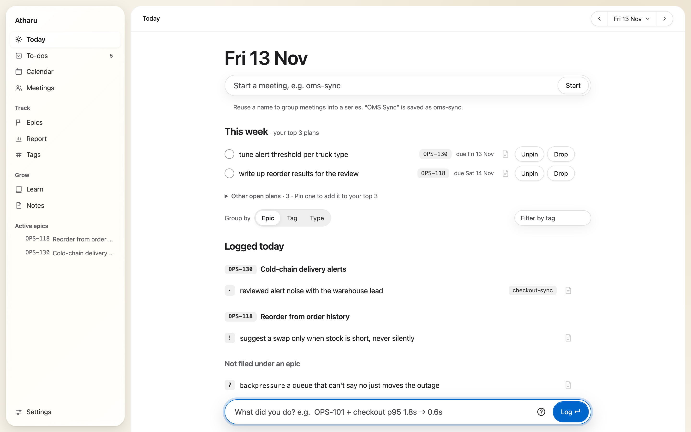
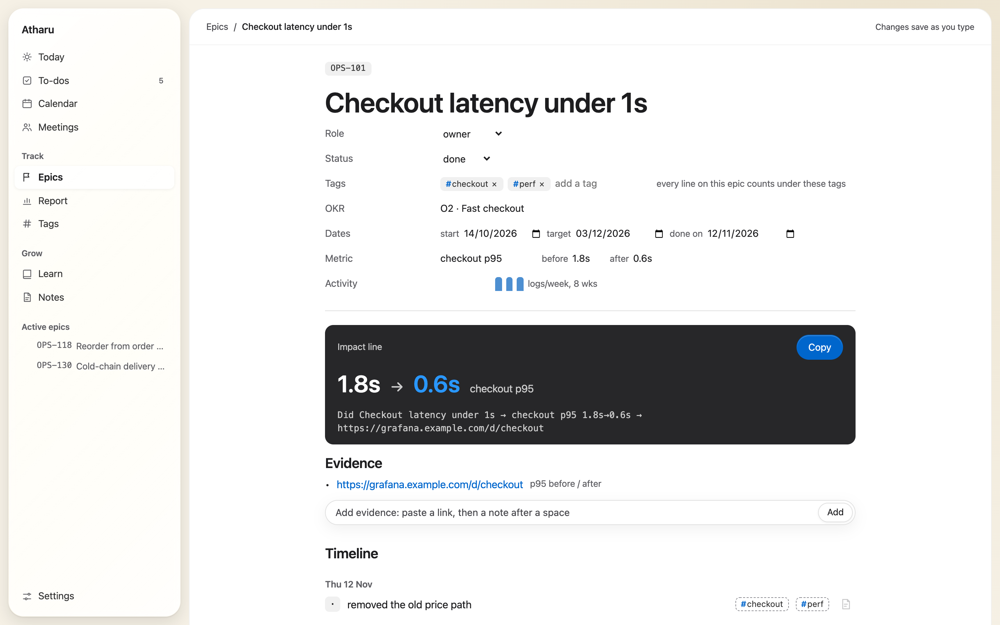
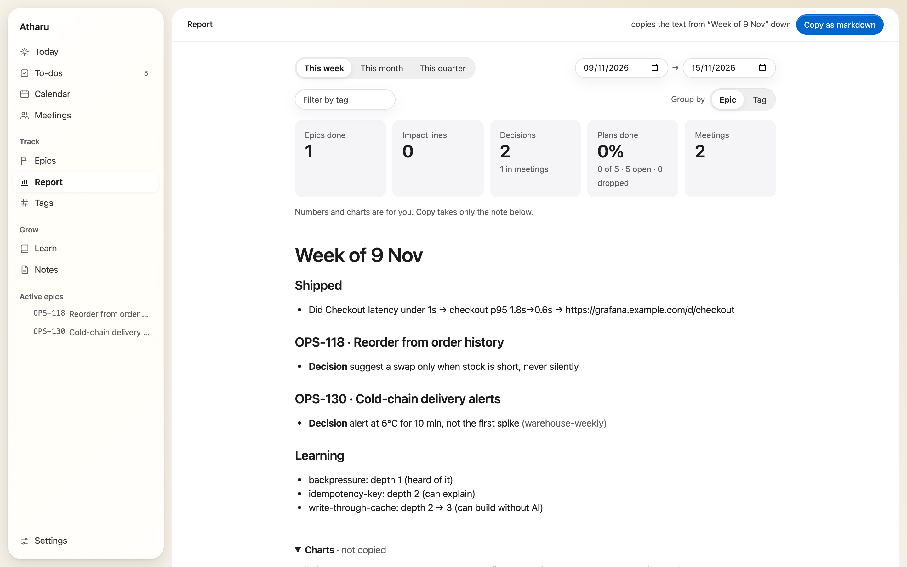
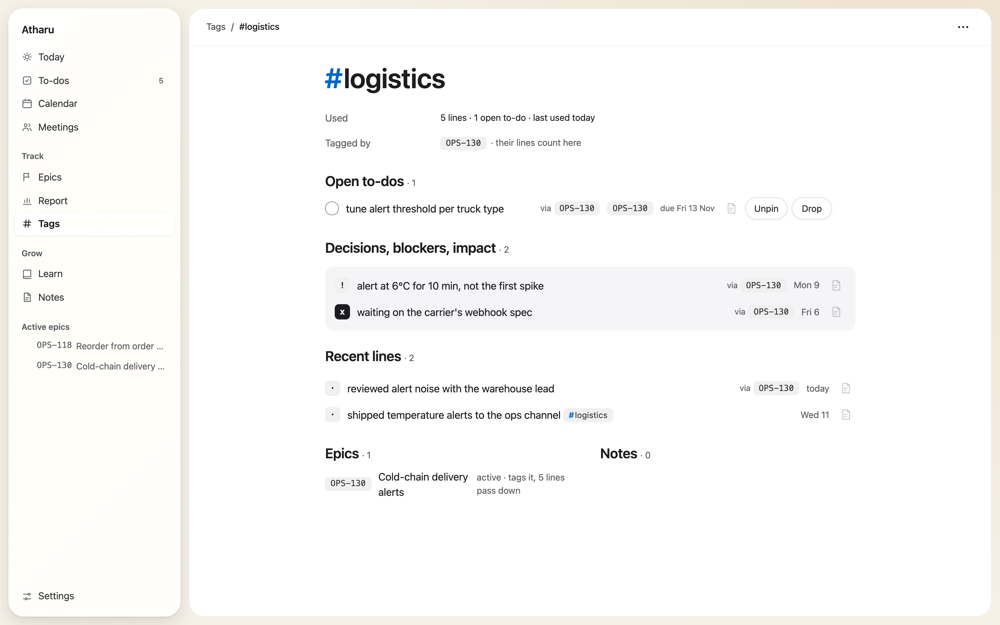
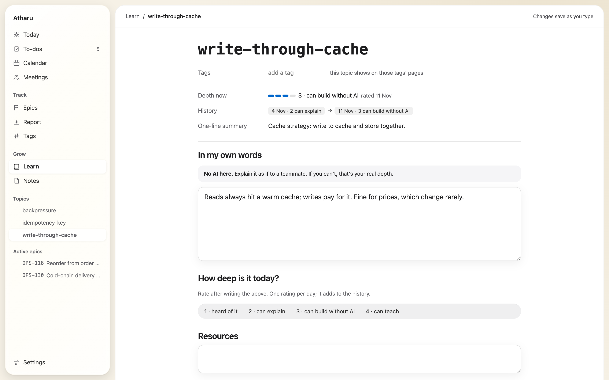

<p align="center">
  
</p>

<h1 align="center">Atharu <sub>أثر</sub></h1>

<p align="center">
  <b>A local-first work log for engineers.</b><br>
  One line per thing you did, rolled up into epics, impact and a weekly report, with meeting notes and transcripts that never leave your machine.
</p>

<p align="center">
  <a href="https://github.com/erumtw/atharu/releases/latest"></a>
  
  
  
</p>

<p align="center">
  
</p>

## Why

Performance reviews ask what you shipped and what it changed. By then the answers are scattered across Slack, Jira and memory.
Atharu keeps them in one place as you go: you type one short line, and it files it under the right epic, tags it, and turns
the week into a report you can paste.

- **One line, typed fast.** `OPS-101 + checkout p95 1.8s → 0.6s` is an impact on epic OPS-101. The grammar is a handful of prefixes, no forms.
- **Local-first.** One Rust binary and one SQLite file on `127.0.0.1`. No account, no cloud, no telemetry.
- **Agent-friendly.** A JSON CLI lets coding agents (Claude Code, Codex) log what they did *as themselves*. They never edit what you wrote.

## Features

| | |
|---|---|
| **Today** | A capture bar with live parsing, your top 3 plans for the week, and today's lines grouped by epic, tag or type. |
| **To-dos** | `> reply to vendor by fri` becomes a to-do with a due date. Typing `by` opens a date menu, and ticking a to-do asks for the follow-up. |
| **Epics** | Jira-keyed projects with OKR, dates, a before → after metric, evidence links, and an impact line ready to copy; Jira status, parents, your assigned issues and status moves on press. A filter box, Group by (OKR, Jira status, parent, tag) and Show (active, done & dropped, all) narrow both lists, and Hide tracked trims the assigned one; it all lives in the URL. |
| **Report** | Week, month or quarter: what shipped, decisions, blockers and learning, copied as Markdown in one click. |
| **Learn** | `? topic: what clicked`. Topic pages hold your own words and a 1–4 depth rating over time, and are deliberately AI-free. |
| **Notes** | A block editor with `[[links]]`, `#tags`, toggles, callouts and hand-drawn Excalidraw diagrams. |
| **Tags** | `#tag` anywhere. Each tag gets a hub page that gathers lines, to-dos, epics and notes, with tags inherited from an epic or meeting series. |
| **Meetings** | Start a meeting from Today. Lines logged during it file under it. The Mac app records **on device**: Whisper transcription with a Me / Others split by voice. |
| **Calendar** | Day, N days, week and month views of your own events plus read-only Google Calendar (iCal) and, in the Mac app, macOS Calendar. |
| **Looks** | Four themes (Sumi, Sora, Wakaba, Glass) with Liquid Glass chrome, Reduce Transparency and Increase Contrast fallbacks. |

<table>
  <tr>
    <td width="50%"><br><sub><b>Epic</b>: the metric, its evidence and an impact line ready to copy.</sub></td>
    <td width="50%"><br><sub><b>Report</b>: the week as Markdown, with numbers kept for you.</sub></td>
  </tr>
  <tr>
    <td width="50%"><br><sub><b>Tag hub</b>: everything under <code>#logistics</code>, including what an epic passes down.</sub></td>
    <td width="50%"><br><sub><b>Learn</b>: your own words and depth over time.</sub></td>
  </tr>
</table>

<sub>Screenshots use a demo database (Acme Grocer). None of it is real work data.</sub>

## The line grammar

```text
[EPIC-KEY] [prefix] text [#tag …] [link] [by <when>]
```

| Prefix | Kind | Example |
|---|---|---|
| *(none)* | done | `OPS-101 shipped index migration` |
| `!` | decision | `OPS-101 ! keep sync path, no queue` |
| `x ` | blocker | `OPS-101 x waiting on DBA` |
| `+` | impact | `OPS-101 + p95 1.8s → 0.6s` |
| `?` | learn | `? vector-search: HNSW trades recall for speed` |
| `>` | to-do | `> reply to vendor https://… by fri` |

An unknown epic key creates a stub epic, the first link is kept as the line's link, and `by` takes `today`, `tomorrow`, a weekday, `20 Nov` or `2026-11-20`.

## Install

Requires macOS or Linux with a Rust toolchain (`rustup`). The Mac app also needs Xcode command-line tools.

```sh
git clone https://github.com/erumtw/atharu && cd atharu
scripts/install.sh          # builds the newest release tag → ~/.cargo/bin/atharu
scripts/install.sh --app    # …and the Mac app → /Applications/Atharu.app
atharu                      # serves http://127.0.0.1:7070
```

Later, `atharu update [--app] [--docker]` installs the newest release if there is one. `--version vX.Y.Z` pins a tag, and
`--dev` builds the latest commit instead. The script prints the `PATH` / `ATHARU_DB` lines to add; it never edits your shell profile.
In the Mac app, Settings › About › Update does the same with buttons: Check for updates, Update (it builds the newest release tag with
`scripts/install.sh --version <tag> --app`, writing its output to `update.log` next to your database), then Restart Atharu.

<details>
<summary><b>Docker</b></summary>

```sh
docker compose up -d --build   # http://localhost:7070, published on 127.0.0.1 only; DB in ./data
docker compose down
```
</details>

<details>
<summary><b>Mac app</b></summary>

Tauri 2 on the system WebView. It serves the same pages on a free local port and lives in the menu bar.
<kbd>Ctrl</kbd><kbd>Opt</kbd><kbd>Space</kbd> opens a compact popover from anywhere: one field to log a line (pick a kind, or type `!` `x` `+` `?` `>`),
`n ` or <kbd>⌘</kbd><kbd>N</kbd> for a quick note, one row to start a meeting (a mic toggle records it), and today's to-dos. `n ` works in
Today's capture bar too.

- **Database:** it uses `~/atharu/data/atharu.db` when that file exists, so the browser, CLI, agents and app share one
  log. Otherwise it uses `~/Library/Application Support/dev.atharu.desktop/atharu.db`. Settings › About › Database file
  changes it (applied after **Restart**), and `ATHARU_DB` always wins.
- **Recording:** ScreenCaptureKit audio, whisper.cpp (`large-v3-turbo`) and sherpa-onnx speaker diarization, all on
  device. Building it needs `scripts/sherpa-onnx.sh` once (a SHA-256-pinned static library).
- **Manual build:** `cargo install tauri-cli --version "^2" --locked`, then `cd src-tauri && cargo tauri build`. That gives an
  unsigned `Atharu.app` and a `.dmg`. The Dock icon follows the look you pick.
</details>

## Configuration

| Variable | Default | |
|---|---|---|
| `ATHARU_HOST` | `127.0.0.1` | bind address |
| `ATHARU_PORT` | `7070` | port |
| `ATHARU_DB` | `data/atharu.db` | SQLite file |
| `ATHARU_AGENT` | — | CLI writer name, e.g. `claude` |

Optionally, add `data/config.toml` next to the database with `ical_url = "…"`, Google Calendar's secret iCal address. It's shown read-only on
`/calendar` and refreshed every 15 minutes. It's a credential, so keep it out of git.

**Jira** (`jira_base_url`, `jira_email`, `jira_token` in the same file, an API token from
https://id.atlassian.com/manage-profile/security/api-tokens): Atharu reads the title, status, type, parent, due and resolution
dates of the keys you log, plus the open issues assigned to you, every 15 minutes or on Refresh. It writes one thing only: a
status move, when you pick one from a Jira chip's ▾ (with Undo). If Jira refuses the token, Epics and Settings say "Token expired or
revoked" with a link to make a new one, and the last copy stays shown.

**Mac calendars** (Mac app only): when your Google Workspace blocks the iCal address, add the account in macOS Calendar instead, then
turn on Settings › Connections › Mac calendars and tick the calendars to show. macOS asks once for Calendar access. The app reads them
(read-only) into `/calendar` on start, every 15 minutes and whenever Calendar changes; a browser on the same database shows what it synced.

## For AI agents

Agents write through the CLI, never through SQL, and always under their own name:

```sh
atharu log "OPS-101 shipped the price cache" --as claude
atharu note "Reorder flow" --file notes.md --links OPS-118 --as claude
atharu today                # JSON: that day's lines + open plans
atharu show OPS-101         # JSON: epic + evidence + timeline
```

What they file shows with a name badge, and the report marks it `(via claude)`. The full contract, including tables, write rules
and exit codes, is in [`AGENTS.md`](AGENTS.md).

## Development

```sh
cargo run                                                       # http://127.0.0.1:7070, creates + migrates data/atharu.db
cargo fmt --check && cargo clippy --all-targets -- -D warnings && cargo test
cd editor && npm ci && npm run check && node build.mjs          # strict TypeScript → committed static/js/*.js
```

- **Stack:** Rust (axum, rusqlite, Askama), htmx, Tiptap for notes, Tauri 2 for the Mac app.
- **Layout:** vertical slices (`src/<feature>/{handlers,queries,view}.rs`) plus a pure `src/domain/`. SQL only in `queries.rs`, HTML only in `templates/`.
- **Design:** [`DESIGN.md`](DESIGN.md) is the design system (Apple look, Liquid Glass on floating chrome, Notion-style UX). Read it before touching the UI.
- **Spec:** [`docs/superpowers/specs/2026-09-28-atharu-design.md`](docs/superpowers/specs/2026-09-28-atharu-design.md).

### Releases

`main` is development, and each minor line gets a `release/X.Y` branch. Releases are annotated tags cut by `scripts/release.sh`:

```sh
scripts/release.sh 0.2.0            # on main: bump, CHANGELOG.md, commit, tag v0.2.0, update release/0.2
scripts/release.sh --hotfix 0.2.1   # on release/0.2 after committing the fix there
```

It refuses a dirty tree, a version that isn't higher, or the wrong branch. See [`CHANGELOG.md`](CHANGELOG.md) and
[Releases](https://github.com/erumtw/atharu/releases).

## Privacy

Everything stays on your machine: the server binds to `127.0.0.1`, recordings are transcribed on device, and `data/` is
gitignored. The only network calls are the ones you configure: Jira (reads, and status moves you pick), a Google Calendar iCal feed (macOS Calendar is read on this Mac), and the one-time model downloads for transcription and the speaker split (Hugging Face).
